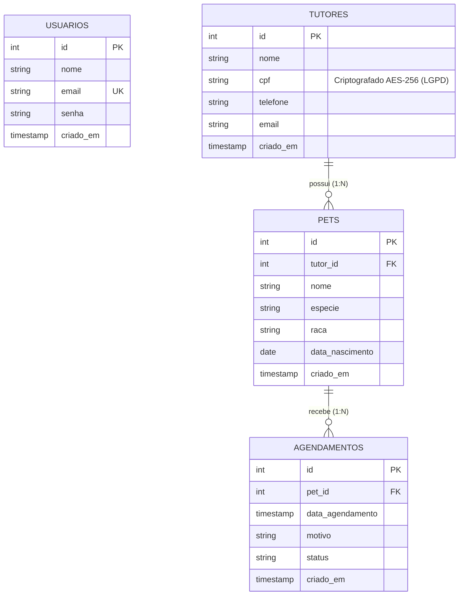

# Sistema de Gestão de Clínica Veterinária (PHP + PostgreSQL)

Sistema web simples, funcional e seguro para controle de agendamentos, tutores e pets em clínicas veterinárias, desenvolvido em **PHP puro (MVC sem framework)**, **PostgreSQL (via PDO)** e em estrita conformidade com as diretrizes da **LGPD (Lei Geral de Proteção de Dados)**.

---

## 1. Documentação Técnica

### 1.1. Requisitos do Sistema (RF e RNF)

Em conformidade com a restrição de escopo de no máximo 4 requisitos:

1. **[RF01] Autenticação com Expiração de Sessão:** O sistema deve autenticar operadores por e-mail e senha utilizando verificação criptográfica com algoritmo Bcrypt. A sessão de trabalho deve ser encerrada compulsoriamente após 30 minutos de inatividade, exigindo novo login para continuidade de uso.
2. **[RF02] Gestão Integrada de Tutores, Pets e Agendamentos:** O sistema deve permitir o cadastro e edição de tutores com suporte a busca rápida por nome ou CPF; o cadastro de pets obrigatoriamente vinculados a um tutor existente; e a listagem de agendamentos ordenados cronologicamente pela data da consulta, com permissão para remarcação da data de agendamentos já registrados.
3. **[RNF01] Proteção Criptográfica de Dados Pessoais (LGPD):** O CPF dos tutores deve ser protegido e persistido no banco de dados exclusivamente sob criptografia simétrica forte (AES-256-CBC) com vetor de inicialização (IV) aleatório de 16 bytes. A chave de criptografia deve ser obtida de arquivo de configuração externo (`config/database.ini`) ou de variável de ambiente (`APP_KEY`), nunca hardcoded no código. A descriptografia deve ocorrer estritamente em memória no momento de exibição ou edição.
4. **[RNF02] Arquitetura Segura e Documentação Técnica:** O sistema deve seguir o padrão arquitetural MVC simplificado em PHP puro, comunicando-se com o PostgreSQL via PDO com *Prepared Statements* em todas as consultas para imunização contra *SQL Injection*, escape de caracteres em todas as saídas HTML contra *Cross-Site Scripting (XSS)*, e acompanhado de Diagrama Entidade-Relacionamento (DER) e especificação das tabelas.

---

### 1.2. Diagrama Entidade-Relacionamento (DER)

Abaixo está o diagrama entidade-relacionamento em formato textual **Mermaid**:



---

### 1.3. Dicionário de Dados e Descrição das Tabelas

#### Tabela `usuarios`
Armazena os operadores que possuem acesso autenticado ao sistema (administradores, recepcionistas e veterinários).
- `id` (SERIAL, Chave Primária): Identificador sequencial único do operador.
- `nome` (VARCHAR(100), NOT NULL): Nome completo do usuário.
- `email` (VARCHAR(120), NOT NULL, UNIQUE): E-mail institucional utilizado como login.
- `senha` (VARCHAR(255), NOT NULL): Hash da senha gerado com algoritmo seguro Bcrypt (custo 12).
- `criado_em` (TIMESTAMP, NOT NULL, DEFAULT CURRENT_TIMESTAMP): Data e hora de criação do usuário.

#### Tabela `tutores`
Armazena as informações de contato dos tutores dos animais.
- `id` (SERIAL, Chave Primária): Identificador único do tutor.
- `nome` (VARCHAR(150), NOT NULL): Nome completo do tutor.
- `cpf` (VARCHAR(255), NOT NULL): **Dado pessoal sensível protegido conforme a LGPD**. Armazena o texto cifrado gerado por AES-256-CBC concatenado com o IV e codificado em Base64.
- `telefone` (VARCHAR(20), NOT NULL): Número de contato/WhatsApp.
- `email` (VARCHAR(120), NOT NULL): E-mail do tutor.
- `criado_em` (TIMESTAMP, NOT NULL, DEFAULT CURRENT_TIMESTAMP): Timestamp de inclusão do registro.

#### Tabela `pets`
Armazena os dados dos animais que recebem atendimento na clínica.
- `id` (SERIAL, Chave Primária): Identificador único do pet.
- `tutor_id` (INTEGER, NOT NULL, FK -> `tutores.id` ON DELETE CASCADE): Chave estrangeira que garante a obrigatoriedade da associação do animal a um tutor válido.
- `nome` (VARCHAR(100), NOT NULL): Nome do animal.
- `especie` (VARCHAR(50), NOT NULL): Espécie do pet (Cachorro, Gato, Ave, etc.).
- `raca` (VARCHAR(50), NOT NULL): Raça do animal.
- `data_nascimento` (DATE, NOT NULL): Data de nascimento estimada ou exata do animal.
- `criado_em` (TIMESTAMP, NOT NULL, DEFAULT CURRENT_TIMESTAMP): Timestamp de inclusão do registro.

#### Tabela `agendamentos`
Controla os atendimentos e consultas agendados.
- `id` (SERIAL, Chave Primária): Identificador do agendamento.
- `pet_id` (INTEGER, NOT NULL, FK -> `pets.id` ON DELETE CASCADE): Chave estrangeira referenciando o pet consultado.
- `data_agendamento` (TIMESTAMP, NOT NULL): Data e hora do atendimento agendado.
- `motivo` (VARCHAR(255), NOT NULL): Descrição do atendimento solicitado ou sintomas relatados.
- `status` (VARCHAR(30), NOT NULL, DEFAULT 'Agendado'): Situação do agendamento ('Agendado', 'Confirmado', 'Concluído').
- `criado_em` (TIMESTAMP, NOT NULL, DEFAULT CURRENT_TIMESTAMP): Timestamp de criação do agendamento.

---

### 1.4. Decisões Arquiteturais e Conformidade com a LGPD

1. **Criptografia Simétrica de CPF (AES-256-CBC):**
   - O CPF é classificado como dado pessoal pela LGPD (Art. 5º, I). Para mitigar os riscos de vazamento em caso de incidentes de segurança com o banco de dados, o campo `cpf` é cifrado no PHP antes de ser persistido no PostgreSQL.
   - Foi utilizado o modo **CBC** com vetor de inicialização (`IV`) de 16 bytes gerado criptograficamente com `random_bytes()`. Isso impede que o mesmo CPF gere a mesma sequência cifrada no banco, prevenindo ataques estatísticos por dicionário ou frequência.
2. **Busca por CPF Criptografado:**
   - Como o IV é aleatório, não é possível realizar uma busca determinística com `WHERE cpf = '...'` no banco sem expor padrões.
   - Em consonância com a arquitetura enxuta para pequenos negócios veterinários, a busca realiza a leitura e descriptografa em memória com tratamento seguro, permitindo buscas tanto por correspondência exata quanto parcial dos dígitos do CPF, sem expor dados desprotegidos nos logs do banco de dados PostgreSQL.
3. **Expiração Automática de Sessão:**
   - Toda requisição verifica o timestamp `$_SESSION['ultimo_acesso']`. Se a inatividade for superior a 1800 segundos (30 minutos), a sessão é destruída e o usuário é redirecionado à tela de login com alerta informativo.
4. **Prevenção a SQL Injection e XSS:**
   - 100% das consultas utilizam `PDO::prepare()` com parâmetros vinculados (`execute([$param => $valor])`).
   - 100% das saídas HTML passam pela função `htmlspecialchars($var, ENT_QUOTES, 'UTF-8')`.

---

## 2. Estrutura de Diretórios

O projeto segue rigorosamente a estrutura demandada:

```
sistema/
├── config/
│   └── database.ini       # Configuração do banco PostgreSQL e chave AES-256
├── public/
│   └── index.php          # Front Controller único da aplicação
├── src/
│   ├── Controllers/       # Controllers da aplicação (MVC)
│   │   ├── AgendamentoController.php
│   │   ├── AuthController.php
│   │   ├── Controller.php
│   │   ├── HomeController.php
│   │   ├── PetController.php
│   │   └── TutorController.php
│   ├── Core/              # Núcleo da arquitetura
│   │   ├── AuthGuard.php  # Controle de sessão e expiração por inatividade
│   │   ├── ConexaoBanco.php # Conexão Singleton com PostgreSQL via PDO
│   │   ├── Criptografia.php # Implementação AES-256-CBC e utilitários de CPF
│   │   └── Roteador.php   # Roteador HTTP simples e direto
│   ├── Models/            # Camada de dados com Prepared Statements
│   │   ├── Agendamento.php
│   │   ├── Pet.php
│   │   ├── Tutor.php
│   │   └── Usuario.php
│   └── Views/             # Camada de apresentação em HTML/CSS limpo
│       ├── agendamentos/  (cadastrar.php, editar.php, index.php)
│       ├── auth/          (login.php)
│       ├── home/          (index.php)
│       ├── layout/        (auth.php, main.php)
│       ├── pets/          (cadastrar.php, index.php)
│       └── tutores/       (cadastrar.php, editar.php, index.php)
├── vendor/                # Autoloader PSR-4 gerado pelo Composer
│   ├── composer/
│   └── autoload.php
├── composer.json          # Mapeamento do namespace App\ -> src/
├── README.md              # Documentação técnica e instruções
└── schema.sql             # Criação das tabelas e carga inicial de 3 registros
```

---

## 3. Instruções de Instalação e Configuração

### 3.1. Pré-requisitos
- **PHP 8.0 ou superior** com as extensões `pdo`, `pdo_pgsql` e `openssl` habilitadas.
- **PostgreSQL 12 ou superior** instalado e em execução.
- **Composer** (opcional para rodar de imediato, pois o diretório `vendor/` já está pronto com autoloader PSR-4).

### 3.2. Configuração do Banco de Dados PostgreSQL

1. Crie o banco de dados no PostgreSQL (via `psql` ou pgAdmin):
```sql
CREATE DATABASE clinica_vet;
```

2. Execute o arquivo `schema.sql` para criar a estrutura das tabelas e popular os 3 registros iniciais de cada entidade:
```bash
# Via terminal psql:
psql -U postgres -d clinica_vet -f schema.sql
```

### 3.3. Configuração do arquivo `config/database.ini`

Abra o arquivo `config/database.ini` e ajuste as credenciais do seu banco de dados se necessário:

```ini
[database]
driver = pgsql
host = localhost
port = 5432
dbname = clinica_vet
user = postgres
password = sua_senha_do_postgres

[security]
; Chave simétrica de 256 bits (32 bytes) para criptografia do CPF dos tutores
app_key = c11n1c4_v3t_53cr3t_k3y_2026_lgpd

; Tempo de expiração da sessão por inatividade em segundos (30 minutos = 1800)
session_lifetime = 1800
```

> **Dica de Produção:** Se preferir, você pode exportar variáveis de ambiente no servidor sem alterar o arquivo:
> `export DB_HOST=localhost`, `export DB_NAME=clinica_vet`, `export DB_USER=postgres`, `export DB_PASSWORD=...`, `export APP_KEY=...`.

### 3.4. Autoload com o Composer

O projeto já inclui o diretório `vendor/autoload.php` funcional. Caso deseje regenerá-lo via Composer:
```bash
composer dump-autoload
```

---

## 4. Execução do Sistema

Para iniciar a aplicação localmente utilizando o servidor web embutido do PHP, execute no terminal a partir da raiz da pasta `sistema/`:

```bash
php -S localhost:8000 -t public public/index.php
```

Abra o navegador e acesse:
**[http://localhost:8000](http://localhost:8000)**

---

## 5. Instruções de Uso e Credenciais de Teste

### 5.1. Credenciais Pré-cadastradas no `schema.sql`

O banco de dados já contém 3 usuários prontos para autenticação imediata:

| Operador | E-mail de Acesso | Senha Padrão | Perfil |
| :--- | :--- | :--- | :--- |
| **Administrador Geral** | `admin@clinica.com` | `admin123` | Gestor da Clínica |
| **Maria Recepcionista** | `maria@clinica.com` | `recepcao123` | Recepção e Agendamento |
| **Dr. Carlos Veterinário** | `carlos@clinica.com` | `vet123` | Atendimento Clínico |

### 5.2. Fluxo das Funcionalidades

1. **Login e Sessão com Expiração:**
   - Acesse `/login`, digite e-mail e senha.
   - Em caso de credenciais incorretas, uma mensagem explicativa em vermelho é exibida.
   - Após 30 minutos de inatividade, qualquer nova tentativa de navegação encerra a sessão e redireciona para a tela de login com o alerta de sessão expirada.
2. **Tela Principal (Dashboard):**
   - Apresenta o nome do usuário logado no topo, links para Tutores, Pets, Agendamentos e o botão **Sair** no menu.
   - Exibe cartões com totalizadores e uma listagem dos próximos agendamentos da clínica.
3. **Gestão de Tutores (Busca e Edição com Criptografia LGPD):**
   - Acesse **Tutores**. Você verá a lista com os CPFs formatados e protegidos com a tag LGPD.
   - **Busca por Termo:** Digite o nome ou parte do CPF no campo de busca e clique em **Buscar**. A lista é instantaneamente filtrada.
   - **Edição de Tutor:** Clique em **Editar** em qualquer tutor, altere os dados e clique em **Salvar Alterações**. O CPF é recifrado com a nova chave e atualizado no banco.
4. **Gestão de Pets (Vinculação Obrigatória):**
   - Acesse **Pets** &rarr; **+ Novo Pet**.
   - No formulário, o campo **Tutor Responsável** é obrigatório e preenchido através de um seletor com os tutores cadastrados, impedindo pets órfãos no banco.
5. **Agendamentos de Consultas (Ordenação e Remarcação de Data):**
   - Acesse **Agendamentos**. Todas as consultas aparecem ordenadas de forma cronológica crescente por data e hora (`ORDER BY data_agendamento ASC`).
   - Cada linha exibe os dados do paciente (nome e espécie), os dados do tutor responsável (nome e telefone de contato), o motivo e o status.
   - **Alteração de Data:** Clique no botão **📅 Alterar Data** ao lado do agendamento desejado, escolha a nova data/horário e clique em **Salvar Nova Data**. O agendamento é imediatamente atualizado no PostgreSQL.